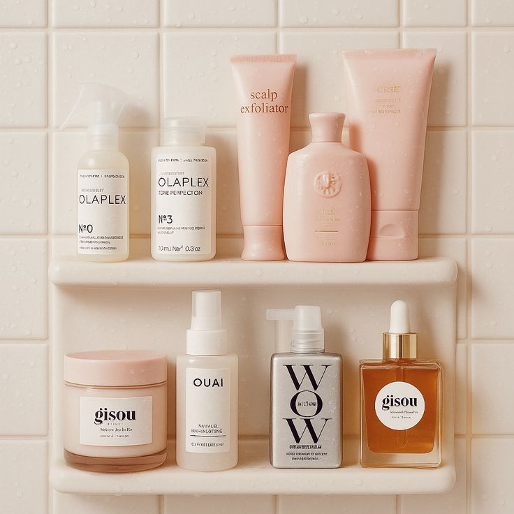
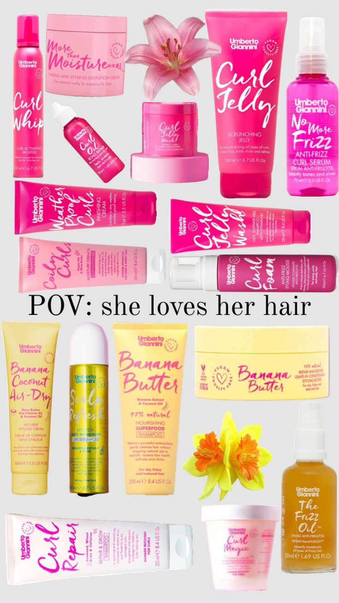
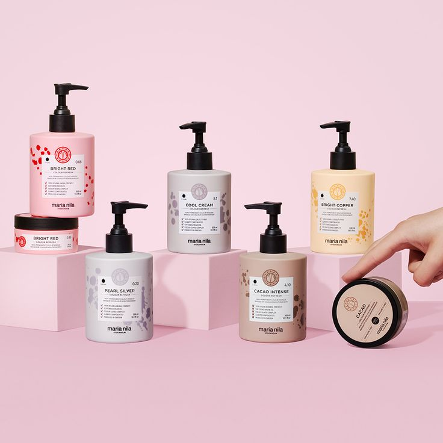
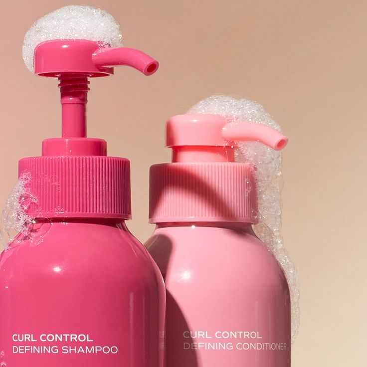
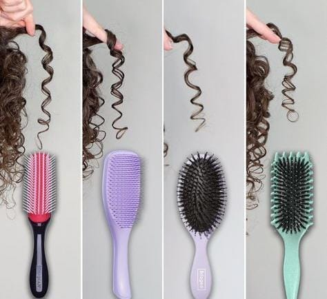

<div align="center">
  

  # Curlography – Curly Hair Care E-Commerce Website

  **A Responsive Curly Hair Care E-Commerce Landing Page**

  [🌐 Live Demo](https://itsmebhavya.github.io/Curlography/) |
  [💻 GitHub Repository](https://github.com/itsmebhavya/Curlography)

</div>

---

## 📌 About the Project

**Curlography** is a responsive front-end e-commerce landing page designed for a curly hair-care platform. It showcases a variety of hair-care products through a modern, attractive, and user-friendly interface.

The website is developed using **HTML5 and CSS3**, focusing on responsive web design, product presentation, navigation, and an organized shopping experience.

## ✨ Features

- Responsive website design for different screen sizes.
- Attractive hero section with a background image.
- Navigation bar with logo, search bar, and menu options.
- Product showcase with individual product images.
- Clean and modern user interface.
- Organized footer with useful links and information.
- CSS Flexbox for layout alignment.
- CSS Media Queries for responsive styling.

## 🖥️ Website Preview

<div align="center">
  
</div>

## 🛍️ Product Gallery

<div align="center">
  <table>
    <tr>
      <td align="center">
        
        <br><b>Curl Defining</b>
      </td>
      <td align="center">
        
        <br><b>Curl Gel</b>
      </td>
      <td align="center">
        
        <br><b>Hair Mask</b>
      </td>
    </tr>
    <tr>
      <td align="center">
        
        <br><b>Curl Shampoo</b>
      </td>
      <td align="center">
        
        <br><b>Hair Brush</b>
      </td>
      <td align="center">
        
        <br><b>Hair Oil</b>
      </td>
    </tr>
  </table>
</div>

## 🛠️ Technologies Used

| Technology | Purpose |
|---|---|
| HTML5 | Website structure and content |
| CSS3 | Styling and visual design |
| CSS Flexbox | Layout and alignment |
| CSS Media Queries | Responsive webpage design |

## ⚙️ How It Works

- **HTML5:** Structures the webpage into different sections, including navigation, hero, products, and footer.
- **CSS3:** Adds colors, typography, spacing, and visual styling.
- **Flexbox:** Organizes webpage elements and product layouts.
- **Media Queries:** Adjust the layout for different screen sizes.
- **Images:** Display hair-care products and enhance the visual shopping experience.

## 📂 Project Structure

```text
Curlography/
│
├── .git/
│
├── index.html
├── style.css
│
├── Curlo_logo.png
├── hero_section.jpeg
├── Curl_Defining.jpg
├── Curl_gel.jpg
├── Curl_hair_Mask.jpeg
├── Curl_shampoo.jpg
├── Hair_brush.jpg
├── Hair_care.jpeg
└── Hair_oil.jpg
```

## 🚀 How to Run the Project Locally

1. Clone the repository:

   ```bash
   git clone https://github.com/itsmebhavya/Curlography.git
   ```

2. Navigate to the project directory:

   ```bash
   cd Curlography
   ```

3. Open the project in Visual Studio Code.

4. Open `index.html` in your browser.

## 🌐 Live Demo

Explore the deployed website:

**[https://itsmebhavya.github.io/Curlography/](https://itsmebhavya.github.io/Curlography/)**

## 📌 Project Highlights

- Developed a responsive curly hair-care e-commerce landing page using HTML5 and CSS3.
- Designed an attractive product showcase with organized product cards and images.
- Implemented responsive layouts using CSS Flexbox and Media Queries.
- Deployed the website using GitHub Pages.

## 👩‍💻 Author

**Bhavya Swami**

- GitHub: [@itsmebhavya](https://github.com/itsmebhavya)
- Project Repository: [Curlography](https://github.com/itsmebhavya/Curlography)
- Live Website: [Curlography](https://itsmebhavya.github.io/Curlography/)

---

<div align="center">

**Made with ❤️ using HTML5 & CSS3**

</div>
